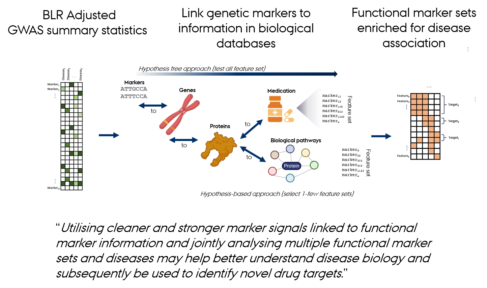

<!-- README.md is generated from README.Rmd. Please edit that file -->

```{r, echo = FALSE}
knitr::opts_chunk$set(
  collapse = TRUE,
  comment = "#>",
  fig.path = "README-"
)
```

### An R Package for Creating a Database of Genomic Associations of Complex Traits


The R package ***gact*** is designed for establishing and populating a comprehensive database focused on genomic associations with complex traits. The package serves two primary functions: infrastructure creation and data acquisition. It facilitates the assembly of a structured repository that includes single marker associations, carefully curated to maintain high data quality. Beyond individual genetic markers, the package integrates a broad spectrum of genomic entities, encompassing genes, proteins, and an array of biological complexes (chemical and protein), as well as various biological pathways. It is designed to aid in the biological interpretation of genomic associations, shedding light on their complex relationships in the context of genomic associations of complex traits.

**gact** provides an infrastructure for efficient processing of large-scale genomic association data, including core functions for:  
 
* Establishing and populating a database for genomic association.
* Downloading and processing a range of biological databases.
* Downloading and processing summary statistics from genome-wide association studies (GWAS).
* Conducting bioinformatic procedures to link genetic markers with genes, proteins, metabolites, and biological pathways.
* Finemapping of genomic regions using Bayesian Linear Regression models.
* Performing advanced gene set enrichment analysis utilizing a variety of tools and methodologies.

<br>



<br>


<br>

**gact** constructs gene and genetic marker sets from a range of biological databases including: 

- `"Ensembl"`: Gene, protein, transcript sets derived from the [Ensembl](https://www.ensembl.org/index.html) database.
- `"Regulation"`: Regulatory genomic feature sets derived from the [Ensembl Regulation](https://www.ensembl.org/info/genome/funcgen/index.html) database.
- `"GO"`: Gene Ontology sets from the [GO](https://geneontology.org) database.
- `"Pathways"`: Pathway sets from the [Reactome](https://reactome.org) and [KEGG](https://www.genome.jp/kegg/pathway.html) databases.
- `"ProteinComplexes"`: Protein complex sets derived from the [STRING](https://string-db.org) database.
- `"ChemicalComplexes"`: Chemical complex sets derived from the [STITCH](http://stitch.embl.de/) database. 
- `"DrugGenes"`: Drug-gene interaction sets the [DrugBank](https://go.drugbank.com) database.
- `"DrugATCGenes"`: Drug ATC gene sets based on the [ATC](https://www.whocc.no/atc_ddd_index/) and [DrugBank](https://go.drugbank.com) databases.
- `"DrugComplexes"`: Drug gene complex sets combining information from [STRING](https://string-db.org) and [DrugBank](https://go.drugbank.com).
- `"DiseaseGenes"`: Disease-gene sets based on experiments, textmining and knowledge base derived from the [DISEASE](https://diseases.jensenlab.org/Search) database.
- `"GTEx"`: GTEx project eQTL sets derived from the [GTEx](https://www.gtexportal.org/home/downloads/adult-gtex/overview) database.
- `"GWAScatalog"`: GWAS catalog sets derived from the [GWAScatalog](https://www.ebi.ac.uk/gwas/) database.
- `"VEP"`: Variant Effect Predictor sets derived from the [Ensembl Variant Effect Predictor](https://grch37.ensembl.org/info/docs/tools/vep) database.

<br>


[gact AI assistant](help.html)

### Installation of the gact package

Install gact from GitHub and the standalone gsuite analysis packages with:

Source installation needs a C++17 build toolchain, such as matching Rtools on
Windows, Xcode Command Line Tools on macOS, or R's configured compiler on Linux.
Building gact also needs zlib headers and a linkable zlib library, included with
Rtools on Windows. R installs the package dependencies from the configured
repositories.

```{r,  eval=FALSE, echo=TRUE}
install.packages("remotes", repos="https://cloud.r-project.org")
options(repos=c(
  gsuite="https://psoerensen.github.io/gtools/gsuite/repository",
  CRAN="https://cloud.r-project.org"
))
remotes::install_github("psoerensen/gact")
gact::install_gsuite()
```

`install_gsuite()` checks the gsuite source repository for the latest versions
compatible with your R session. It installs missing or older packages and
verifies the versions in the destination library.

#### Installing with a shared or locked R library

Start a fresh R session before loading gact or gbase. Run the following first
to put a personal library ahead of the shared library, then run the install
commands above.

```{r, eval=FALSE}
lib <- path.expand("~/R/gsuite-library")
dir.create(lib, recursive = TRUE, showWarnings = FALSE)
.libPaths(c(lib, .libPaths()))
```

Use a separate directory for each R environment. Repeat the `.libPaths()`
line before loading gact in later sessions, or configure `R_LIBS_USER`
for that environment. This also works when the shared library contains a
`00LOCK-gbase` directory. If you manage the original library and want to
install there, remove a leftover lock only after confirming no installation
is using that library.

### Export a GWAS association matrix

New studies are aligned during ingestion. Use `recodeStat()` to align an
existing summary-statistics file to the same marker catalog. By default it
replaces the file after validation. Use `out_file` to keep the original.
When replacing a registered study, update its recorded checksum using the
returned MD5.

```{r, eval=FALSE}
gact::writeMarkerStat(GAlist)
```

By default, `gstat/matrix/` holds the column-major FP64 Z matrix and TSV
catalogs. Rows follow `GAlist$rsids`. Columns follow the full study inventory,
which must contain at least two studies. Missing scores are stored as NaN.
The export reports each LD panel and completed study column by default.
Use `progress = FALSE` to suppress these updates. Record each study's
ancestry in the inventory to enable LD matching for imputation.
The writer finds sparse LD by study ancestry in the marker
directory, using the aligned BED stems `g1000_eur.subset.aligned`,
`g1000_eas.subset.aligned` and `g1000_sas.subset.aligned`. Use
`addLDPanels()` for custom paths. Align BED dosage alleles to the gact
effect alleles before calculating LD. The writer checks the LD allele
order and stores a four-byte Z row index per LD row.

For an existing GRCh37 database, use
`GAlist <- gact::downloadDB(GAlist, what = "ldetect")` to install the EUR
and EAS Berisa–Pickrell files in the marker directory. New `hsa.GRCh37.0.0.1`
databases install the files during creation. The export adds
`ld_regions.tsv` and paired Z and LD row indices. gminer reads the indices
to load slices in LD order.

With gminer installed, impute missing scores from the matching sparse LD.
For an export in a different directory, pass its path as `matrix_dir`.

```{r, eval=FALSE}
out <- gminer::gminer(GAlist, task = "impute")
read.delim(out$counts)
```

### Tutorials for downloading and installing the gact database
Below is a set of tutorials used for the gact package:  

Download, save and reopen the gact database, inspect its contents, and review storage and timing information:

[Download and install gact database](Document/Download_and_install_gact_database.html)  


Download and process genotype data from the 1000 Genomes Project (1000G) for different ancestries (European, East Asian, South Asian) used in different genomic analysis:   
[Download and process of 1000G data](Document/Process_1000G.html)  

Computing sparse Linkage Disequilibrium (LD) matrices for 1000 Genomes Project (1000G) data across different ancestries and exploring the LD data which is used in a number of genomic analysis (LD score regression, Vegas gene analysis, Bayesian Linear Regression models):   
[Compute sparse LD matrices for 1000G data](Document/Compute_sparseLD_1000G.html)  

Downloading and processing genome-wide association summary statistic and ingest into database:   
[Download and process new GWAS summary statistics](Document/Download_and_process_gwas.html)  


### Tutorials for various types of genomic analysis using the gact database 

Check summary statistics against reference LD and impute missing Z-scores for
multiple studies:

[Summary-statistics imputation](Document/Impute_summary_statistics.html)

Gene analysis using the VEGAS (Versatile Gene-based Association Study) approach using the 1000G LD reference data processed above:   
[Gene analysis using VEGAS](Document/Gene_analysis_vegas.html)  

Gene set enrichment analysis (GSEA) based on BLR (Bayesian Linear Regression) model derived gene-level statistics and MAGMA (Multi-marker Analysis of GenoMic Annotation) (Bai et al. 2024).   
[Gene set analysis using MAGMA](Document/Gene_set_analysis_magma.html)  

Pathway prioritization using a single and multiple trait Bayesian MAGMA models and gene-level statistics derived from VEGAS (Gholipourshahraki et al. 2024).   
[Gene set analysis using Bayesian MAGMA](Document/Gene_set_analysis_bayesian_magma.html)  

Gene ranking with chromosome-held-out ridge, BayesC and BayesR PoPS models using gene-level statistics derived from VEGAS.

[Gene ranking using PoPS](Document/Gene_ranking_bayesian_pops.html)  

Individual-level linear regression and LOCO mixed-model association using the standalone glma package on the same simulated-human panel:
[Linear regression and LOCO mixed models with glma](Document/Glma_linear_and_mixed_models_simulated_data.html)

Individual-level BayesC and BayesR, full and scheduled marker updates, held-out prediction and genetic variance decomposition on sparse and polygenic simulated traits:
[Individual-level Bayesian regression with gbayes](Document/Gbayes_individual_level_simulated_data.html)

Finemapping with single trait Bayesian Linear Regression models and simulated data (Shrestha et al. 2023).    
[Finemapping using BLR models on simulated data](Document/Finemapping_bayesian_linear_regression_simulated_data.html)  

Finemapping of gene and LD regions using single trait Bayesian Linear Regression models (Shrestha et al. 2023).    
[Finemapping using BLR models on real data](Document/Finemapping_bayesian_linear_regression_real_data.html)  

Polygenic scoring (PGS) using Bayesian Linear Regression models and biological pathway information (work in progress).    
[Polygenic scoring using BLR models](Document/Polygenic_scoring_bayesian_linear_regression.html)  

Polygenic scoring (PGS) using summary statistics from PGS catalog and biological pathway information.    
[Polygenic scoring using PGS Catalog](Document/Polygenic_scoring_pgscatalog.html)  

LD score regression for estimating genomic heritability and correlations.    
[LD score regression](Document/LD_score_regression.html)  

CAD/T2D genetic correlation with standalone gcorr: stored LD scores,
regional HESS/rho-HESS, timing and memory.

[Genetic correlation with gcorr](Document/Genetic_correlation_CAD_T2D_gcorr.html)


[Benchmark overview](Document/Benchmark_overview.html): consolidated runtime, memory, simulated scoring evidence and remaining measurement gaps.

[Workflow requirements and interpretation](Document/Download_and_install_gact_database.html#workflow-requirements)

### Workshop and Course Materials

**Workshop:**  
*From Integrative Genomics to Polygenic Risk Scoring* — presented at the [**9th Annual Danish Bioinformatics Conference**](https://eventsignup.ku.dk/9danishbioinfconference).  

- [**Workshop Slides (HTML)**](Document/workshop_slides.html)  
- [**Demonstration Slides (PDF)**](Document/workshop_slides.pdf)

**Course:**  
*Bayesian Linear Regression* — theoretical notes, lecture slides, and practical R examples.  
[**Course Materials**](https://psoerensen.github.io/bayesian-linear-regression/)


#### Funding  
These notes and scripts are prepared in the BALDER project funded by the ODIN platform. ODIN is sponsored by the Novo Nordisk Foundation (grant number NNF20SA0061466)

#### References  

1. Rohde PD, Sørensen IF, Sørensen P. qgg: an R package for large-scale quantitative genetic analyses. *Bioinformatics* 36:8 (2020). https://doi.org/10.1093/bioinformatics/btz955  

2. Rohde PD, Sørensen IF, Sørensen P. Expanded utility of the R package, qgg, with applications within genomic medicine. *Bioinformatics* 39:11 (2023). https://doi.org/10.1093/bioinformatics/btad656  

3. Shrestha et al. Evaluation of Bayesian Linear Regression Models as a Fine Mapping Tool. *Submitted* (2024) https://doi.org/10.1101/2023.09.01.555889  

4. Bai et al. Evaluation of multiple marker mapping methods using single trait Bayesian Linear Regression models. *BMC Genomics* 25:1236 (2024). https://doi.org/10.1186/s12864-024-11026-2  

5. Gholipourshahraki et al. Evaluation of Bayesian Linear Regression Models for Pathway Prioritization. *PLOS Genetics* 20(11) e1011463 (2025). https://doi.org/10.1371/journal.pgen.1011463.

6. Kunkel et al. Improving polygenic prediction from summary data by learning patterns of effect sharing across multiple phenotypes. *Plos Genetics* 21 (1), e1011519 (2025). https://doi.org/10.1371/journal.pgen.1011519.


### Build a database from source annotations

Use `task = "build"` to prepare a new database and its marker sets. GRCh37
uses the published marker backbone. GRCh38 builds its backbone from prepared
chromosome tables and receipts. Both builds download the source
annotations, build the sets with `createSetsDB()`, and save `GAlist` in the
new version directory. GO and drug gene memberships come from the published
annotation bundle.

```r
GAlist <- gact(version = "hsa.GRCh37.0.0.1", dbdir = dbdir, task = "build")
GAlist <- gact(version = "hsa.GRCh38.0.0.1", dbdir = dbdir, task = "build")
```

For GRCh38, gact looks under `dbdir` and its parent for `reference/prepared_grch38/`,
`prepared_grch38/`, or `reference/grch38-prep.*/tables/`. If it finds no complete
set, it downloads and verifies the IGSR, UCSC and gnomAD inputs and prepares
the tables chromosome by chromosome. This requires gsim with
`gsim_scan_vcf()` and disk space for the raw inputs. Set `workers = 2L` in
`gact()` to prepare two gnomAD lookups concurrently. Each active worker
can stage a full gnomAD chromosome VCF. The build reports download and preparation progress
and keeps completed chromosome pairs in `dbdir/reference/grch38-prep.auto/tables/`
for retries.

### Install prepared NYGC genotype panels

```r
GAlist <- downloadDB(GAlist, what = "1000G")
```

For GRCh38, this installs the five ancestry panels from the
[versioned Zenodo record](https://doi.org/10.5281/zenodo.24292610).
It verifies the archive and member SHA-256 checksums and puts the
`g1000_<ancestry>.bed`, `.bim` and `.fam` files in `marker/`.

### Rebuild the GRCh38 marker backbone from IGSR inputs

`hsa.GRCh38.0.0.1` has a local build workflow for marker sets and GWAS data.
The finished release saves all 22 prepared chromosome tables, their receipts,
and matching compact gnomAD lookups under `GAlist$dirs[["reference"]]`.
The preparation cache beside the release is retained for retries.

To prepare the marker backbone separately,
run `prepareIGSRMarkers()` for chromosomes 1–22 with a version of gsim that
exports `gsim_scan_vcf()`.
The downloader verifies the [IGSR 2019-03-12 GRCh38 VCFs](https://ftp.1000genomes.ebi.ac.uk/vol1/ftp/data_collections/1000_genomes_project/release/20190312_biallelic_SNV_and_INDEL/)
and [UCSC chromosome FASTAs](https://hgdownload.soe.ucsc.edu/goldenPath/hg38/chromosomes/)
against their release manifests. It also verifies the gnomAD v4.1 genomes
VCF for each chromosome, writes a compact rsID lookup and checksum receipt, and
removes the downloaded gnomAD VCF after processing. Each chromosome requires
temporary space for its full VCF. Use `include_rsids = FALSE` if you already
have lookup tables. Preparation checks reference alleles and
uses the panel's global alternate allele count divided by allele number. The
default scope is PASS, biallelic autosomal SNVs with a global MAF of at least 1%.

```r
dbdir <- "/path/to/gactcore"
reference_dir <- file.path(dbdir, "reference")
tables <- file.path(reference_dir, "prepared_grch38")
inputs <- downloadReferenceInputs("IGSR", reference_dir = reference_dir)
for (chr in 1:22) {
  prepareIGSRMarkers(chr, panel_dir = inputs$panel_dir, fasta_dir = inputs$fasta_dir,
    rsid_dir = inputs$rsid_dir, out_dir = tables)
}
GAlist <- buildMarkerDB(input_dir = tables, dbdir = dbdir)
```

The build writes `marker/markers.txt.gz`, `marker/cpra.txt.gz`, a marker provenance
manifest, and `GAlist_hsa.GRCh38.0.0.1.rds` under the new version directory. The saved
descriptor can be passed to `runGWASManifest()`. GRCh38 LD and annotation bundles
are separate resources and are pending for this version. The matching NYGC
genotypes are available separately.

To prepare the existing marker database for publication, use
`packageMarkerDB(dbdir, out_dir)`, where `dbdir` is the GRCh38 database root
and `out_dir` is a separate release directory. Upload the returned
`archive` and `checksum_file` to Zenodo. The GRCh38 download installer
requires a published marker bundle registered for the release.

### Package and reuse the GRCh38 reference

```r
bundles <- packageReference(GAlist)
```

This writes the prepared chromosome archive and, when available, the compact
gnomAD lookup archive with their SHA-256 files in the release's `reference/`
directory. The files include the original receipts. For an older release,
gact can also package the matching tables and lookups from its build cache.

For a future build, verify the table archive's SHA-256 and extract its files
into `<new dbdir>/reference/prepared_grch38/` to skip chromosome preparation.
To repeat chromosome preparation with the archived lookups, call
`installGnomadLookups(bundles$gnomad$archive, file.path(new_dbdir, "reference"))`.
The log reports download, checksum, and scan-and-write times for any full
gnomAD VCFs still needed.

### Rebuild NYGC 30× GRCh38 genotype panels from VCFs

`buildNYGCGenotypes()` writes one BED/BIM/FAM triplet for all 22 autosomes
per ancestry (AFR, AMR, EAS, EUR and SAS). It checks each NYGC VCF and index against the release
manifest and matches biallelic SNPs to the existing GRCh38 marker catalog by
chromosome, position, REF and ALT. The BED dosage counts catalog ALT.

The downloader fetches and verifies the [2022-04-22 phased VCFs and indexes](https://ftp.1000genomes.ebi.ac.uk/vol1/ftp/data_collections/1000G_2504_high_coverage/working/20220422_3202_phased_SNV_INDEL_SV/)
and checks the [Phase 3 sample panel](https://ftp.1000genomes.ebi.ac.uk/vol1/ftp/release/20130502/integrated_call_samples_v3.20130502.ALL.panel).
Install gsim with `gsim_scan_vcf()`, phased VCF import
and BED export. gsim streams the chromosome VCF and extracts the genetic map
from `INFO/CM`. Region requests also scan sequentially.

```r
inputs <- downloadReferenceInputs("NYGC", reference_dir = "reference")
buildNYGCGenotypes(input_dir = inputs$input_dir,
  marker_catalog = "marker/markers.txt.gz",
  out_dir = "nygc-grch38/marker")
```

Create the standalone parent directory `nygc-grch38` first. The build creates
its `marker` subdirectory with files such as `g1000_eur.bed`, `.bim` and
`.fam`, plus `nygc-panels.json` with counts, input provenance and checksums.
The triplets can be passed to `gbase::gprep()`.

For a parallel build, run `prepareNYGCGenotypes()` for each autosome in a
shared staging directory, then call `mergeNYGCGenotypes()` on those files.
The merge checks the chromosome receipts and consistent sample order before
publishing the output directory. For a short test, pass a `regions` data
frame with `chromosome`, `start` and `end` columns to `buildNYGCGenotypes()`.

### Inspect downloaded GWAS files before ingestion

`inspectGWAS()` reads bounded leading previews and joins local files to a TSV
metadata table. It prepares recipes, `review.tsv`, `formats.json`, and a separate
`ingest.R` script. The output directory must be new or empty and outside the
input directory. Use `file_column` and `metadata_mapping` when the metadata table
uses different names. Missing or ambiguous metadata remains visible in the
review table.

The schema detector recognizes `effect_se` as a standard-error column.

```r
inspection <- inspectGWAS(
  data_dir = "mops/human_GWAS/final_hg38",
  metadata = "all_229_trait_summary.tsv",
  out_dir = "gwas_recipe_review",
  preview_rows = 1000
)
inspection$review
```

The folder name does not establish genome build. Supply confirmed metadata in
the table or through `defaults`, for example `defaults = list(build = "GRCh38")`.
Review recipes before executing `Rscript gwas_recipe_review/ingest.R GAlist.rds`.
The generated script uses the existing ingestion API and writes the database.
Preview checks cover only sampled rows; full-file validation and alignment take
place during ingestion. The script is a sequential first-import script and
reruns use existing gact behavior; it is not a resumable campaign manager.

Format learning persists as explicit, source-specific knowledge. Correct an
entry in `formats.json`, document the evidence, and set `verified` to `true`.
Pass that file as `knowledge` to subsequent inspections. Only exact source and
header matches reuse verified mappings. New observations remain unverified.
This function performs local inspection; an agent can interpret source
publications and curate the saved knowledge between runs.

### Run a GWAS manifest

`runGWASManifest()` uses one TSV row per study. Supply `accession`, `filename`,
`url`, `md5`, `source`, `trait`, `type`, `build`, and `ancestry`. Shared study
metadata can instead be supplied in `defaults`, with manifest values taking
precedence. Use the study accession and file metadata for the exact download.
A PMID identifies a publication, which can contain multiple GWAS studies.

```r
report <- runGWASManifest(
  manifest = "studies.tsv",
  descriptor = "GAlist.rds",
  data_dir = "download",
  out_dir = "recipes/batch-01",
  knowledge = "recipes/verified/formats.json",
  defaults = list(source = "Catalog release", build = "GRCh37",
                  type = "binary", ancestry = "Mixed"),
  import = FALSE
)
```

The download cache is checked against the manifest MD5. A verified match for
the source and exact header is required for automatic ingestion. Check
`manifest_review.tsv` for unverified formats, invalid inputs, or failed imports
and check the per-study inspection files for mappings and preview warnings.
Use `import = TRUE` to import ready studies and save the updated GAlist. On a
rerun, use a fresh output directory. Accessions already represented in the
database are skipped, including legacy GWAS Catalog study URLs.

After the study and updated GAlist are saved, gact removes the source file
if it downloaded the file itself. The manifest review reports cleanup and
keeps the URL, checksum, and recipe available for reproducibility. Local
files, preview downloads, and downloads from failed imports are retained.

#### Stage a Pan-UK Biobank batch in C++

`scanGWAS()` reads the provider phenotype manifest and looks for a matching
harmonised GRCh38 Catalog file for each selected analysis. It checks study
metadata and uses the C++ reader on a bounded HTTP byte range. The scan writes
recipes and a report without opening a database. Use an ancestry code such
as `"EUR"` or `"CSA"` in the `analysis` column. Supply a reviewed
`accession` when the report flags an ambiguous match.
Automatic matching uses phenotype codes and labels, then verifies the sex,
ancestry and cohort counts for the exact Catalog file.

```r
selection <- data.frame(
  filename = c("biomarkers-30750-both_sexes-irnt.tsv.bgz",
               "phecode-250-both_sexes.tsv.bgz"),
  analysis = c("EUR", "CSA")
)
prepared <- scanGWAS(selection, "panukb-selection")
prepared$review
```

To save verified recipes directly in the database's `recipes/` folder,
pass the existing GRCh38 descriptor.

```r
panukb <- scanGWAS(GAlist = GAlist, repository = "pan-ukb", workers = 8L)
catalog <- scanGWAS(GAlist = GAlist, repository = "gwas-catalog", workers = 8L)
```

Supply `selection` to scan a smaller batch. Without it, gact scans all available
Pan-UKB single-ancestry studies or candidates in the Catalog's published
harmonised-file index. Catalog scans require a single ancestry and exclude
reported meta-analyses, including MTAG. Literal single-cohort wording is not
required. Optional reviewed `cohort_evidence` is retained in recipes but cannot
override these exclusions. Absence of a meta-analysis statement is metadata
screening, not proof of a single-cohort study.

Catalog scans check genome-wide SNP coverage from provider metadata before
requesting a summary-statistics preview. Protein and metabolite GWAS use the
same rules as disease and other quantitative traits. Explicit cis-only,
targeted-region, exome-only, gene-based, and hits-only files have status
`excluded`. Unclear coverage has status `needs_review`. The review records
`coverage` and `coverage_evidence`; only ready studies enter the import manifest.
The scanner still examines the harmonised index's metadata candidates.

If a provider README or publication establishes genome-wide file coverage,
pass reviewed evidence as `coverage_evidence = c(GCST12345678 = "source and
coverage statement")`. Explicit restricted scope in metadata takes precedence.
When scope wording is absent, a genome-wide assay together with at least one
million successfully harmonised variants in the Catalog's small running log
provides screening evidence. The report records the count and log URL. An assay
label, variant count or leading preview alone does not suffice. Missing evidence
still needs review. Known Pan-UKB releases use their documented genome-wide
scope. Rescanning applies these checks before recipe reuse. This is screening,
not a full-file coverage audit.

The GWAS-SSF label is not mandatory: standard columns and supported legacy
harmonised `hm_*` columns are validated from a small C++ preview. Legacy
harmonised coordinates and alleles take precedence over original source columns.
Extra odds/hazard ratios are allowed when consistent with the mapped signed
beta. Missing or ambiguous mappings, conflicting effects and previews without
usable harmonised variants need review. No full summary-statistics download or
ingestion is performed by the scan.


Verified recipes are named by accession and input MD5. Reruns recheck
upstream metadata and reuse a matching recipe without requesting another
summary-statistics preview. Review reports are stored under `recipes/reviews/`.
Sample counts compare numerically when checking saved recipes, so JSON integer
and double representations of the same value agree. Changed counts still
require review.
To scan original Pan-UKB GRCh37 files, use the provider manifest directly
and the liftover map installed in the GRCh38 database.

```r
original <- scanGWAS(
  GAlist = GAlist, repository = "pan-ukb", files = "original",
  selection = data.frame(
    filename = c("biomarkers-30750-both_sexes-irnt.tsv.bgz",
                 "phecode-250-both_sexes.tsv.bgz"),
    analysis = c("EUR", "CSA")
  ),
  workers = 2L
)
original$review
```

Omit `selection` to scan the available ancestry analyses. The original-file
route uses bounded C++ previews and saves ancestry-specific column mappings,
provider MD5, study counts, and a GRCh37 preview verification tied to the
liftover index checksum. Inconclusive builds or missing columns need review.
For prescription phenotypes with no description, the trait label comes from
the provider's phenocode and the recipe records that choice. Reserved filename
characters are encoded in download URLs and use a stable safe cache filename.
Reruns reuse the verified recipes. Ancestries sharing a phenotype file share
its download and checksum. Meta-analysis columns remain unmapped. For binary
traits, case/control allele frequencies remain unmapped and ingestion uses
the marker catalog EAF. Provider confidence flags stay in the source output
and remain outside the importer's filters.

Import the ready original-file recipes with the existing runner.

```r
report <- runGWASManifest(
  original$manifest, descriptor, knowledge = original$knowledge,
  engine = "cpp", workers = 2L
)
```

This opens the installed liftover index during native alignment and verifies
the complete source file against the provider MD5 before importing.

Study-level sample counts stay in study metadata. Inputs with unverified
formats or unclear metadata remain in the review report.
The C++ engine also supports mapped per-variant sample size `n`. Catalog
previews recognise one unambiguous `n`, `N`, `N_sample_size`, `sample_size`,
`n_total` or `total_sample_size` column. Supplied counts must be finite and
positive. Missing counts remain missing, including when every count is absent;
study-level totals are never copied into variant rows. Alignment preserves the
counts, and duplicate variants with differing counts conflict. QC records
`n_with_sample_size` and `n_missing_sample_size` among retained rows.
The recipe records ancillary columns such as Pan-UKB's `low_confidence`
as unmapped. The existing importer applies its own alignment and QC.


Once the scan report is ready, run the manifest to fetch, checksum, and import
the full files. The manifest contains only ready studies.

```r
report <- runGWASManifest(
  prepared$manifest, descriptor = "GAlist.rds", knowledge = prepared$knowledge,
  engine = "cpp", workers = 2
)
attr(report, "out_dir")
```

The C++ option uses a bounded native preview, saves verified
recipes in the database's `recipes/` directory, and stages full study tables
and QC in parallel using a shared marker index. One writer publishes the
successful studies in manifest order and refreshes the inventory and descriptor
once. The R engine remains the default and handles profiles outside the native
engine's gzip TSV, signed-beta, ordinary-p-value scope. Use a verified GRCh38
Catalog accession for the adapter. The original GRCh37 files can use the
liftover map described below.

By default the manifest runner caches input files in the database's
`download/` directory and writes the batch manifest and review reports under
`recipes/reviews/`. Pass `data_dir` or `out_dir` to override those locations.
The C++ marker index and staged outputs live in a per-run scratch directory
that gact removes on exit. Set `scratch_dir` to choose its parent. Otherwise
gact uses `SLURM_TMPDIR` when available or R's temporary directory.

Analysis outputs use `GAlist$dirs[["results"]]`, created as `results/` at the
database root by `createDB()`. Prepared association matrices remain in
`gstat/matrix/`; shared LD and eigen references remain under `marker/`.
This directory registration does not download data or run analyses.

#### Lift GRCh37 GWAS positions during alignment

`gact(task = "build")` prepares the map automatically for GRCh38. For an
existing GRCh38 database, run `buildLiftoverMap(GAlist)`. It caches the
[Pan-UKB variant list](https://pan.ukbb.broadinstitute.org/docs/per-phenotype-files/#variant-manifest-file)
and the [UCSC hg19-to-hg38 chain](https://hgdownload.soe.ucsc.edu/goldenPath/hg19/liftOver/)
under `reference/` and verifies the chain against the UCSC checksum.
The source variant reader accepts `chrom` in the official Pan-UKB variant
list and `chr` in custom lists. Cached downloads are reused when retrying
after an input-format failure.
Map tables use R gzip compression, including with data.table installations
that lack built-in gzip support.

```r
runGWASManifest(manifest, descriptor, knowledge = "formats.json", engine = "cpp")
```

The C++ engine finds the installed map under `marker/liftover-grch37-grch38/`
for GRCh37 inputs targeting GRCh38. Use `liftover_map` to select a custom map.
A verified forward-strand
format profile identifies the coordinate and association columns. For
original Pan-UKB files, select a single-ancestry profile and use
`"neglog10p"` for the p-value scale. Other studies can reuse the same map
for variants that it covers.

The preview must agree with the manifest's source build. Verification needs
at least 10 distinct keys that support only one build and 90% agreement among
those keys. Inconclusive or conflicting previews go to review. The native
worker opens the saved index and lifts GRCh37 rows during alignment. GRCh38
rows go directly to alignment. The same study QC JSON records `n_lifted` and
`liftover_unmapped` for lifted studies. `scanGWAS()` continues to find Catalog
files.

Use `packageLiftoverMap(GAlist, out_dir)` to prepare the map archive and
its SHA-256 file for distribution. Until a release bundle is published, supply
the archive explicitly to `downloadDB(GAlist, what = "liftover", archive = path)`.
For a local archive, keep its `.sha256` file alongside it. For an HTTPS archive,
pass the checksum as `sha256`. Installation verifies the archive, map members,
and compatibility with the destination marker catalog.
